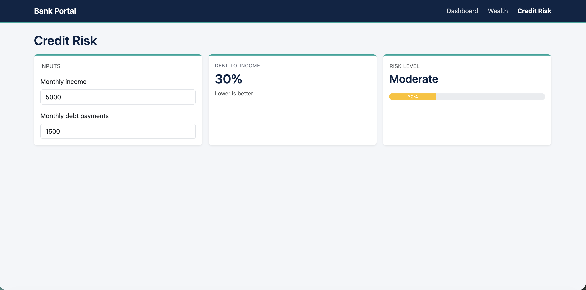

# Bank MFE Portal

A banking micro-frontend portal built with **Nx**, **Angular 22** and **Native Federation**: one shell and two independently built remotes, sharing a UI library.

**[Live demo](https://YOUR_USER.github.io/bank-mfe-portal/)** · [Architecture](docs/architecture.md) · [Decision records](docs/adr/README.md)



> Sample data only. No real financial data is used.

## What this demonstrates

| Topic | How it is shown |
|---|---|
| Micro-frontend architecture | Shell + 2 remotes loaded at runtime |
| Domain boundaries | Wealth and Credit Risk are separate apps |
| Shared design system | `libs/shared-ui` used by all three apps |
| Runtime configuration | Remote URLs come from a manifest, not the build |
| Documented decisions | Six ADRs in `docs/adr` |
| Automated delivery | GitHub Actions deploys to GitHub Pages |

## Applications

| App | Role | Local port | What it shows |
|---|---|---|---|
| `shell` | Host: navigation, routing, remote loading | 4200 | Dashboard |
| `wealth` | Remote: wealth management | 4201 | Portfolio value and allocation |
| `credit-risk` | Remote: credit risk | 4202 | Debt-to-income calculator with risk meter |
| `libs/shared-ui` | Shared library | n/a | `lib-bank-card`, `lib-risk-meter` |

## Tech stack

Nx 24 · Angular 22 · Native Federation (`@angular-architects/native-federation`) · esbuild · Bootstrap 5 · Vitest · ESLint · GitHub Actions · GitHub Pages

## Run locally

Requires Node 22.22.3+, 24.15+ or 26 (Angular 22 requirement).

```bash
npm ci
npx nx run-many -t serve -p shell wealth credit-risk --parallel=3
```

Open http://localhost:4200.

## Quality checks

```bash
npx nx run-many -t lint
npx nx run-many -t test
npx nx run-many -t build
```

## Repository layout

```
apps/
  shell/          host app, routes, federation manifest
  wealth/         remote, exposes ./routes
  credit-risk/    remote, exposes ./routes
libs/
  shared-ui/      shared presentational components
docs/
  architecture.md
  adr/            architecture decision records
.github/workflows/deploy.yml
```

## Documentation

- [Architecture overview](docs/architecture.md)
- [Decision records (ADRs)](docs/adr/README.md)

## Not built yet (deliberately out of scope)

Authentication and session sharing, shared state between remotes, error fallback when a remote is down, contract tests between shell and remotes, version-skew policy, observability. See [architecture.md](docs/architecture.md#known-gaps-and-next-steps).