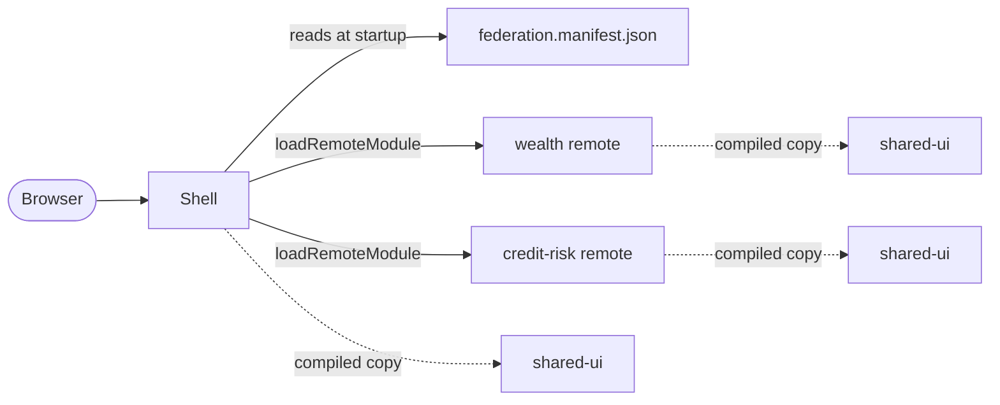
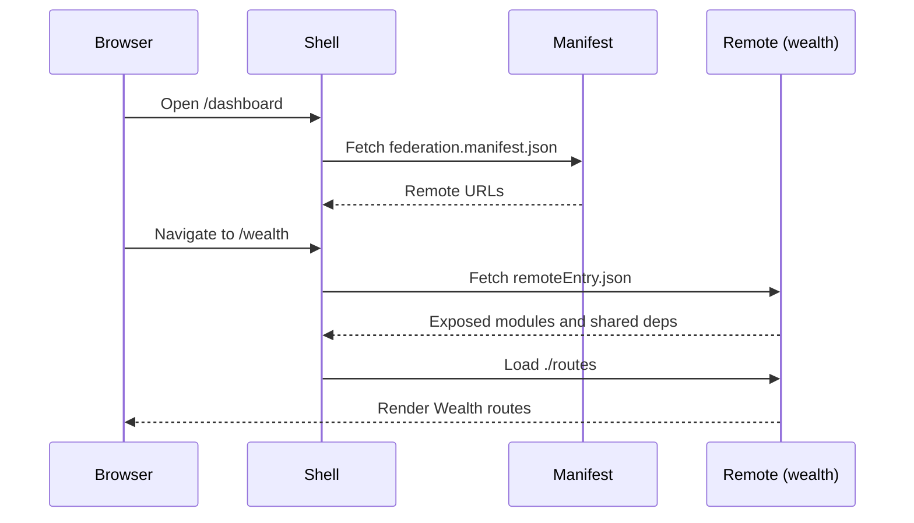

# Architecture

## Context

A shell application composes independently built micro frontends (remotes) for separate banking domains. Remotes are loaded at runtime from URLs listed in a manifest, so a remote can be rebuilt and redeployed without rebuilding the shell, as long as it respects the contract below. See [ADR 0007](adr/0007-independent-releasability.md).

## System view



`shared-ui` is a workspace library, but it is not shared at runtime. Each app bundles its own copy.

## Runtime loading flow



## Boundaries

| Unit | Scope tag | Owns | May depend on |
|---|---|---|---|
| `shell` | `scope:shell` | Navigation, layout, route to remotes | `scope:shared` |
| `wealth` | `scope:wealth` | Wealth management screens | `scope:shared` |
| `credit-risk` | `scope:credit-risk` | Credit risk screens | `scope:shared` |
| `shared-ui` | `scope:shared`, `type:ui` | Presentational components only | Angular only |

Remotes must not import from each other. This is enforced by `@nx/enforce-module-boundaries`, so a violation fails lint and CI. See [ADR 007](adr/0007-independent-releasability.md).

## Runtime contract

These are the only things the shell and remotes agree on at runtime:

1. **Exposed routes.** Each remote exposes `./routes`. The shell loads nothing else.
2. **Manifest.** Remote URLs come from `federation.manifest.json`, not from the build.
3. **Design tokens and global styles.** CSS custom properties (`--bank-navy`, `--bank-accent`) and Bootstrap 5 CSS are provided by the shell. Components use token fallbacks.
4. **Angular.** Angular is a shared singleton.

Everything else, including the UI components, is private to each app and can change without coordination.

## Shared dependencies

Angular and other npm packages are shared as singletons through Native Federation. Workspace libraries are shared by default in this version, so `@bank/shared-ui` is listed in `skip` in each app's `federation.config.mjs`. CI fails if it appears in a remote's `remoteEntry.json`.

## Deployment

Each app deploys on its own through one GitHub Actions workflow. A change detector checks which paths changed, and each app has its own job. A change to `libs/shared-ui` or to the shared config rebuilds all three, because each bundles the library.

Output is published to the `gh-pages` branch, one folder per app:

```
/                          shell build
/federation.manifest.json  production remote URLs, written by the shell job
/404.html                  copy of index.html for deep-link refresh
/remotes/wealth/           wealth build
/remotes/credit-risk/      credit-risk build
```

- Remote jobs replace only their own folder. The shell job keeps the existing `remotes/` folders.
- Before a remote publishes, a contract check fails the job if `./routes` is no longer exposed or if `@bank/shared-ui` is shared at runtime.
- Jobs run in sequence to avoid concurrent pushes to the same branch.

## Known gaps and next steps

- **Authentication:** no login. Next step: shell owns the session and passes a token or context to remotes.
- **Remote failure:** if a remote is down, its route fails. Next step: an error route with a fallback page.
- **Compatibility testing:** the contract check verifies the shape of the build output, not behaviour. Next step: contract tests that load a new remote against the previous shell build.
- **Angular upgrades:** Angular is a shared singleton, so a major upgrade must roll out across all apps together.
- **Release hygiene:** remote URLs are not versioned, so a rollback means redeploying a previous commit. The shell job does not remove old shell assets. Real teams would use a CDN with versioned URLs and separate pipelines.
- **Observability:** none. Next step: shared error and performance reporting.