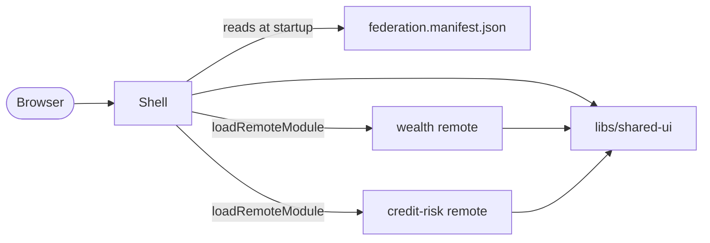
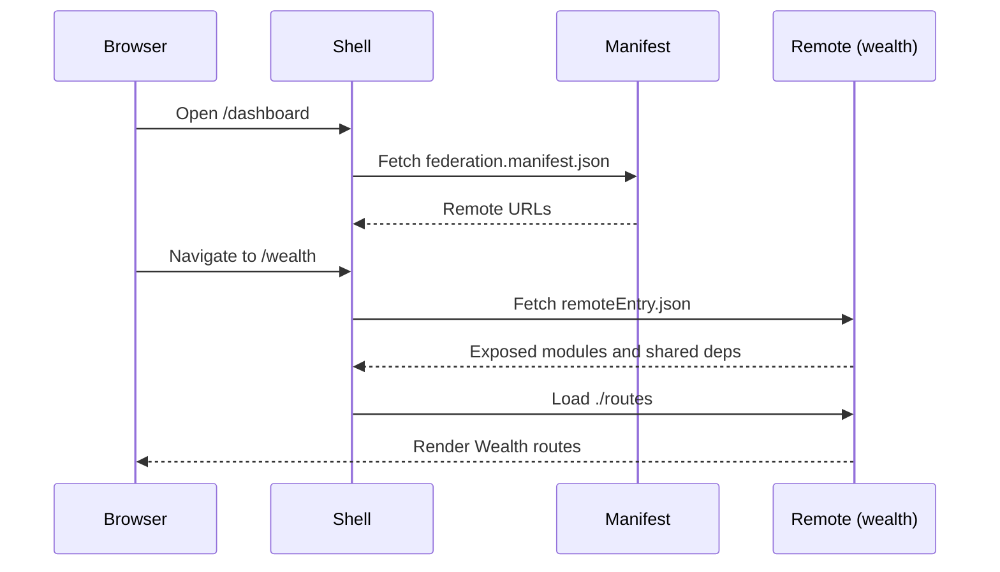

# Architecture

## Context

A shell application composes independently built micro frontends (remotes) for separate banking domains. Remotes are loaded at runtime from URLs listed in a manifest, so a remote can be rebuilt and redeployed without rebuilding the shell.

## System view



## Runtime loading flow



## Boundaries

| Unit | Owns | May depend on |
|---|---|---|
| `shell` | Navigation, layout, route to remotes | `shared-ui` |
| `wealth` | Wealth management screens | `shared-ui` |
| `credit-risk` | Credit risk screens | `shared-ui` |
| `shared-ui` | Presentational components only | Angular only |

Rule: remotes must not import from each other. They share code only through `shared-ui`.

## Shared dependencies

Angular and the shared UI library are shared as singletons through Native Federation, so they load once at runtime rather than once per app.

## Deployment

All three apps are built in one GitHub Actions workflow and published as a single static site on GitHub Pages.

```
site/
  index.html, ...            shell
  federation.manifest.json   production remote URLs
  remotes/wealth/            wealth build output
  remotes/credit-risk/       credit-risk build output
  404.html                   copy of index.html for deep-link refresh
```

The manifest is rewritten at deploy time so production points to the Pages URLs instead of localhost.

## Known gaps and next steps

- **Authentication:** no login. Next step: shell owns the session and passes a token or context to remotes.
- **Remote failure:** if a remote is down, the route fails. Next step: error boundary route with a fallback page.
- **Version skew:** remotes and shell deploy together in this demo. Next step: a compatibility policy and contract tests.
- **Module boundaries:** enforced by convention. Next step: Nx tags and `@nx/enforce-module-boundaries`.
- **Observability:** none. Next step: shared error and performance reporting.
- **Independent deploys:** the workflow builds everything together. Next step: per-remote pipelines.